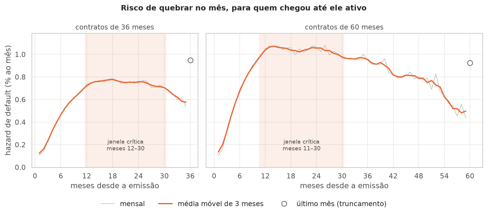
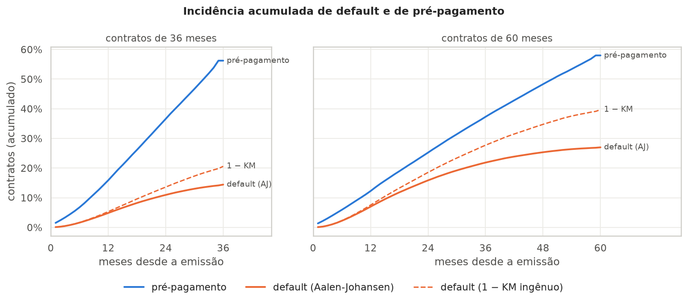
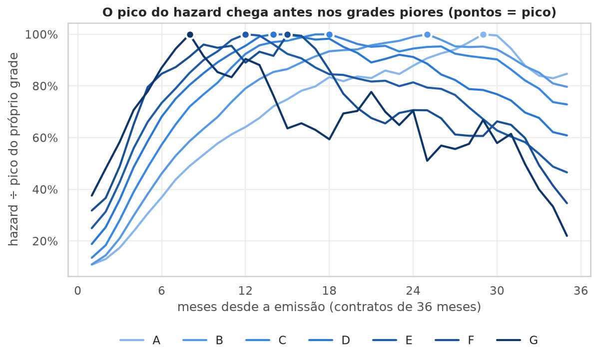
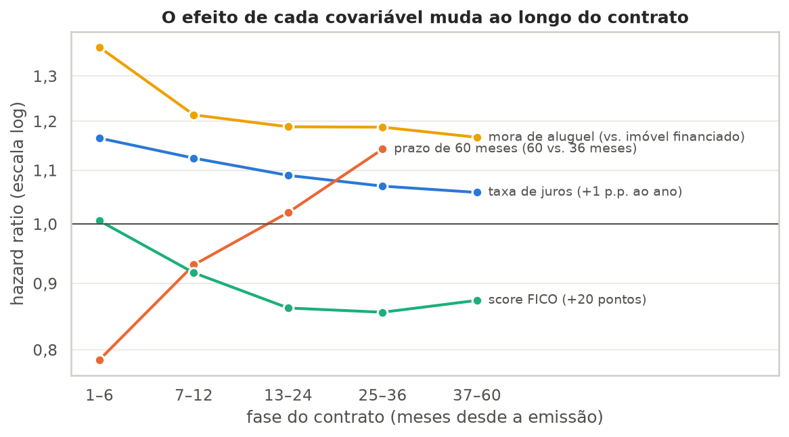
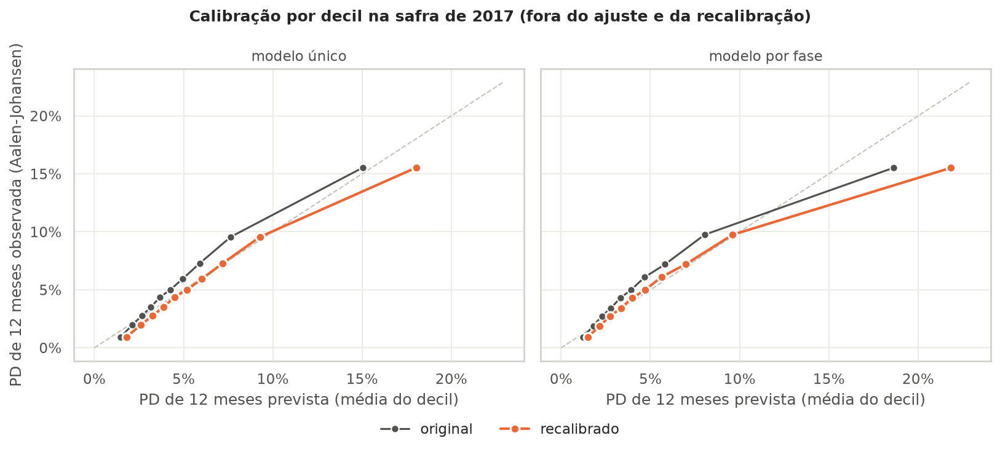
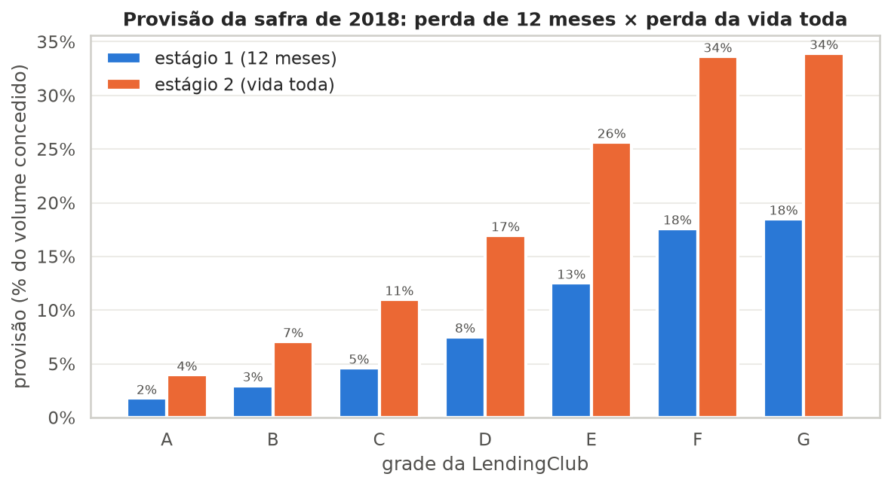
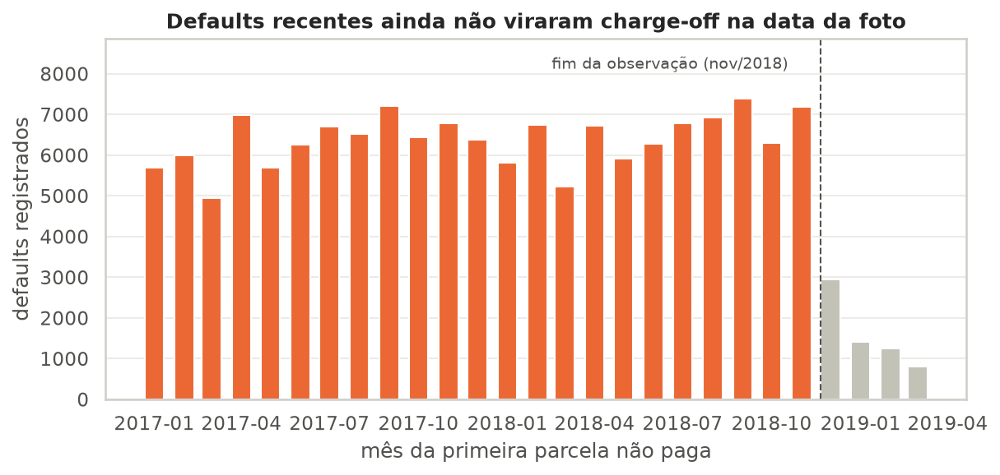

# Tempo até a inadimplência: análise de sobrevivência para cobrança e PCLD

Não basta saber **se** um associado vai inadimplir: para provisionar capital (PCLD) e planejar a cobrança, a cooperativa precisa saber **quando**. Este projeto modela o tempo até o default de 2,1 milhões de empréstimos pessoais com curvas de Kaplan-Meier, riscos competitivos, o modelo de Cox e uma provisão no estilo da Res. CMN 4.966 (IFRS 9).

> **O risco de um contrato de 36 meses sobe 6 vezes no primeiro ano e fica no máximo do 12º ao 30º mês.** Cada +1 p.p. de juros aumenta o risco relativo de default em 9,7% (16% nos 6 primeiros meses). Na provisão, passar um contrato do estágio 1 para o estágio 2 multiplica a reserva por 2,3.



## O problema

Uma cooperativa de crédito precisa de três respostas para cada contrato: **qual a probabilidade de quebra em cada horizonte** (12 meses para o estágio 1 da PCLD, a vida toda para o estágio 2), **em que fase do contrato a cobrança deve agir** e **quais características aceleram a quebra**. Um classificador de default responde só a primeira, e para um único horizonte fixo.

**Dados:** [LendingClub 2007–2018 (Kaggle)](https://www.kaggle.com/datasets/wordsforthewise/lending-club), empréstimos pessoais sem garantia. Depois dos filtros de escopo ficam **2.064.692 contratos** de pedidos individuais. Ao fim da observação, 12,4% tinham dado default, 37,1% tinham sido quitados antes do prazo e 50,5% ainda estavam em aberto ou tinham terminado no prazo (censura).

## Resultados

### 1. Riscos competitivos: o Kaplan-Meier sozinho superestima a perda

Quase 40% dos contratos são quitados antes do prazo, e quem quita deixa de correr risco. O Kaplan-Meier trata esses contratos como se continuassem expostos, então superestima o default acumulado. A incidência acumulada (Aalen-Johansen) dá a fração que de fato inadimple:

| | 36 meses | 60 meses |
|---|---|---|
| Default no prazo, 1 − Kaplan-Meier | 20,6% | 39,7% |
| **Default no prazo, Aalen-Johansen** | **14,4%** | **27,0%** |
| Superestimação do Kaplan-Meier | +43% | +47% |
| Pré-pagamento no prazo | 56,2% | 58,0% |



As curvas de Kaplan-Meier por renda, tipo de moradia e grade estão no notebook 02. Como os empréstimos não têm garantia, o tipo de moradia entra no lugar de "tipo de garantia": em 36 meses, o default vai de 11,8% (imóvel financiado) a 17,1% (aluguel).

### 2. Período crítico: quando o contrato quebra

| | 36 meses | 60 meses |
|---|---|---|
| Hazard no 1º mês | 0,12% a.m. | 0,14% a.m. |
| Hazard no 12º mês | 0,72% a.m. | 1,04% a.m. |
| Pico | mês 18 (0,78%) | mês 14 (1,07%) |
| **Janela crítica** (hazard acima de 90% do pico) | **meses 12–30** | **meses 11–30** |

- **O risco acelera no primeiro ano e fica num platô até perto do 30º mês.** Em perdas, os meses 7 a 18 concentram 46% de todos os defaults dos contratos de 36 meses.
- **Quanto pior o grade, mais cedo a quebra.** O pico vem no mês 8 no grade G e no mês 29 no grade A. A fração dos defaults que acontece no 1º ano vai de 26% (A) a 59% (G). Para a cobrança, isso significa régua preventiva desde os primeiros meses nos grades piores.



### 3. Modelo de Cox: a tabela interpretada

Hazard específico do default (o pré-pagamento é censura), ajustado em 883.528 contratos das safras de 2007 a 2015. O grade ficou de fora porque a LendingClub define o juro a partir dele. O HR é o efeito médio no contrato, e as duas últimas colunas mostram o HR estimado só no começo e só no meio do contrato.

| Leitura (com as demais variáveis fixas) | HR | IC 95% | HR meses 1–6 | HR meses 25–36 |
|---|---|---|---|---|
| Cada +1 p.p. ao ano (taxa de juros) aumenta o risco de default em 9,7% | 1,097 | 1,095–1,099 | 1,16 | 1,07 |
| Cada +10 p.p. da renda (comprometimento com dívidas (DTI)) aumenta o risco de default em 13,6% | 1,136 | 1,129–1,144 | 1,15 | 1,09 |
| Mora de aluguel (vs. imóvel financiado) aumenta o risco de default em 20,6% | 1,206 | 1,192–1,220 | 1,37 | 1,19 |
| Imóvel próprio quitado (vs. imóvel financiado) aumenta o risco de default em 7,8% | 1,078 | 1,059–1,097 | 1,24 | 1,06 |
| Cada +20 pontos (score FICO) reduz o risco de default em 11,5% | 0,885 | 0,880–0,889 | 1,01 | 0,86 |
| Cada renda 2× maior (renda anual) reduz o risco de default em 3,2% | 0,968 | 0,960–0,976 | 0,94 | 0,98 |
| Cada +1 consulta (consultas de crédito em 6 meses) aumenta o risco de default em 8,5% | 1,085 | 1,080–1,091 | 1,11 | 1,07 |
| Tempo de emprego não informado (vs. informado) aumenta o risco de default em 14,9% | 1,149 | 1,123–1,175 | 0,99 | 1,26 |
| Cada +1 p.p. da renda (comprometimento com a parcela (PTI)) aumenta o risco de default em 1,7% | 1,017 | 1,015–1,018 | 1,00 | 1,02 |
| Prazo de 60 meses (60 vs. 36 meses) aumenta o risco de default em 1,5% | 1,015 | 1,003–1,028 | 0,79 | 1,14 |
| Renda verificada (vs. não verificada) aumenta o risco de default em 10,2% | 1,102 | 1,087–1,116 | 1,12 | 1,07 |
| Cada +10 p.p. do limite (uso do rotativo) reduz o risco de default em 5,6% | 0,944 | 0,942–0,947 | 0,95 | 0,94 |
| Atraso de 30+ dias nos últimos 2 anos (sim vs. não) reduz o risco de default em 6,2% | 0,939 | 0,926–0,951 | 0,96 | 0,93 |
| Cada +1 ano (tempo de emprego) reduz o risco de default em 0,5% | 0,995 | 0,993–0,996 | 0,97 | 1,00 |

- **O prazo, sozinho, quase não explica nada.** O HR bruto de 60 vs. 36 meses é 1,45 e cai para 1,02 com controles. O risco maior dos contratos longos vem de quem os contrata e do juro cobrado.
- **Os riscos não são proporcionais.** Juros, prazo e FICO têm efeitos que mudam ao longo do contrato (resíduos de Schoenfeld e um Cox por fase). O FICO não tem efeito nos 6 primeiros meses (HR de 1,01).
- **Uso do rotativo e atraso anterior com HR abaixo de 1** não querem dizer que eles protegem. O score FICO e o preço já usam essa informação: os dois só voltam ao sinal esperado quando o modelo perde juros e FICO juntos.



### 4. Validação fora do tempo (safras de 2016 a 2018)

A previsão combina dois Cox por causa (default e pré-pagamento), estratificados por prazo, pela recursão do Aalen-Johansen.

| C-index no teste | |
|---|---|
| Grade da própria LendingClub, usado como score | 0,682 |
| **Modelo de sobrevivência** | **0,698** |

O modelo ordena bem, mas **subestima as safras novas**, cujo risco subiu: nos contratos de 36 meses da safra de 2016, a PD de 12 meses prevista ficou −20% em relação à observada. Para corrigir, o nível do hazard foi recalibrado nos 12 primeiros meses da safra de 2016 (multiplicador de 1,23). Na safra de 2017, que ficou fora de tudo, a PD média passou de 5,1% para 6,2% prevista, contra 5,7% observada: o viés passou a ser conservador.



### 5. PCLD: estágio 1 × estágio 2

Perda esperada = Σ P(default no mês t) × EAD(t) × LGD, descontada pela taxa do contrato. A **LGD (89,9%)** e o **EAD** (saldo da tabela de amortização × 1,014) foram medidos nos próprios defaults. No backtest, a exposição em default prevista ficou +3,6% em relação à realizada na safra de 2017 (11 meses).

Na safra de 2018, tratada como uma carteira nova de US$ 5,5 bilhões:

| Grade | Estágio 1 (12 meses) | Estágio 2 (vida toda) | Multiplicador |
|---|---|---|---|
| A | 1,8% | 4,0% | 2,2× |
| B | 3,0% | 7,1% | 2,4× |
| C | 4,6% | 11,0% | 2,4× |
| D | 7,5% | 17,0% | 2,3× |
| E | 12,5% | 25,6% | 2,0× |
| F | 17,6% | 33,6% | 1,9× |
| G | 18,5% | 33,9% | 1,8× |
| **Carteira** | **4,1%** | **9,4%** | **2,3×** |

Nos contratos de 60 meses, a provisão sobe de 5,3% para 13,6% (2,6×). Para uma cooperativa, o critério de aumento significativo de risco, que move o contrato para o estágio 2, é uma das decisões de maior impacto no resultado.



## O que eu destacaria

**1. Um viés que só aparece olhando o calendário.** Um contrato só vira charge-off uns 5 meses depois da primeira parcela não paga. Quem parou de pagar perto da data da foto ainda aparece como "em atraso" ou até "em dia", e os defaults dos últimos meses estavam incompletos. Sem corrigir isso, a safra mais recente parecia muito melhor do que era. A solução foi encerrar a observação de todos os contratos em nov/2018 (censura administrativa), o que tirou 71.332 contratos emitidos depois disso.



**2. Riscos competitivos não são um detalhe.** Com 40% de pré-pagamento, ignorar o risco competitivo inflaria a perda acumulada em 43% nos contratos de 36 meses.

**3. O HR único é uma média.** O efeito dos juros cai de 1,16 para 1,06 ao longo do contrato. A tabela do modelo único é um resumo honesto, mas a validação compara também um modelo com efeitos por fase.

**4. Toda decisão registrada.** O arquivo [`docs/decisoes.md`](docs/decisoes.md) traz cada escolha do projeto, as alternativas consideradas e os erros que encontrei e corrigi no caminho.

## Limitações

- **Sem histórico mensal de pagamentos.** O tempo do default é reconstruído a partir do último pagamento, e a PCLD é calculada na concessão. Com dados de comportamento (dias de atraso na data de referência), o mesmo modelo alocaria cada contrato no estágio certo.
- **O risco muda entre safras.** O nível precisa de recalibração periódica, e a calibração fora do tempo é boa na média, mas não em todos os segmentos.
- **Forma funcional dos juros.** O efeito é log-linear no miolo da distribuição, e nas pontas a reta exagera o risco (o decil de juros mais baixos é mais seguro do que o modelo prevê). Uma spline seria a melhoria natural.
- **Pedidos conjuntos fora** (120.710 contratos): renda e DTI do titular não são comparáveis aos de pedidos individuais.
- Os dados são de tomadores dos EUA, em dólares. Os números demonstram o método, não servem como referência de mercado brasileiro.

## Estrutura

```
notebooks/
  01_data_and_events.ipynb   definição do tempo e do evento, filtros e censura administrativa
  02_kaplan_meier.ipynb      Kaplan-Meier, Aalen-Johansen e log-rank por prazo, renda, moradia e grade
  03_critical_period.ipynb   hazard mensal, janela crítica, formato por grade e por safra
  04_cox.ipynb               Cox, tabela interpretada, forma funcional e riscos proporcionais
  05_validation.ipynb        validação fora do tempo, calibração e recalibração
  06_provisioning.ipynb      LGD, EAD, backtest e provisão de estágio 1 e 2
src/time_to_default/         código usado pelos notebooks (eventos, tábua de vida, Cox, previsão, perda esperada)
tests/                       testes unitários (pytest)
reports/                     figuras e metrics.json (fonte dos números deste README)
docs/decisoes.md             diário de decisões, achados e percalços
scripts/                     download_data.py, run_all.sh (reproduz tudo) e build_readme.py (gera este README)
```

## Como reproduzir

Requer [uv](https://docs.astral.sh/uv/) e Python 3.12. Uns 8 GB de RAM bastam: a base é lida em blocos.

```bash
bash scripts/run_all.sh
```

O script baixa a base do Kaggle (375 MB, sem precisar de credencial), instala as dependências, roda os testes, executa os notebooks em ordem e regenera este README.

**Stack:** pandas, lifelines, numpy, matplotlib/seaborn, pytest.
